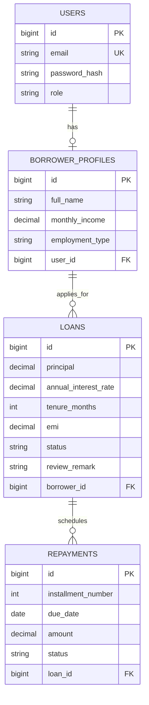

# Udhari

Udhari is a small digital lending demo built with Java 21+, Spring Boot, MySQL, Spring Security, JWT, and Thymeleaf. Borrowers can register, apply for a loan, view their repayment schedule, and track demo payments. An administrator can review applications and approve or reject them.

This project is for demonstration only. It does not disburse loans, process real payments, integrate with a credit bureau, or generate loan agreements.

## Requirements

- Java 21 or newer
- Apache Maven 3.9 or newer
- MySQL 8.0 or newer, running locally or reachable from this machine
- Git (optional)

## Database setup

Create the database and a local application user in MySQL Workbench or another MySQL client. Replace the sample password with a private one and use the same value for `DB_PASSWORD` in `.env`.

```sql
CREATE DATABASE IF NOT EXISTS udhari_db
  CHARACTER SET utf8mb4
  COLLATE utf8mb4_0900_ai_ci;

CREATE USER IF NOT EXISTS 'udhari_app'@'localhost'
  IDENTIFIED BY 'choose-a-private-database-password';

GRANT ALL PRIVILEGES ON udhari_db.* TO 'udhari_app'@'localhost';
```

The app creates or updates its tables on startup through Hibernate. The equivalent manual schema is in [`database/schema.sql`](database/schema.sql). See [`database/README.md`](database/README.md) for details.

## Configure and start

From the project folder, copy the example settings file and edit `.env` with the database password, a private JWT signing secret of at least 32 characters, and optional first-admin credentials. `.env` is ignored by Git.

PowerShell:

```powershell
Copy-Item .env.example .env
```

Example local settings (keep your real values private):

```dotenv
SERVER_PORT=8080
DB_URL=jdbc:mysql://localhost:3306/udhari_db?createDatabaseIfNotExist=true&useSSL=false&allowPublicKeyRetrieval=true&serverTimezone=UTC
DB_USERNAME=udhari_app
DB_PASSWORD=your-private-database-password
JWT_SECRET=replace-with-at-least-32-private-characters
JWT_EXPIRATION_MS=86400000
UDHARI_ADMIN_EMAIL=admin@example.test
UDHARI_ADMIN_PASSWORD=choose-a-private-password-of-12-or-more-characters
```

Set both admin variables before the first startup to create the first ADMIN account. The app does not ship with a default admin password. If an ADMIN already exists in the database, the startup bootstrap leaves it unchanged.

Start the app from the project folder:

```powershell
mvn spring-boot:run
```

Or build and run the packaged application:

```powershell
mvn clean package -DskipTests
java -jar target/udhari-0.0.1-SNAPSHOT.jar
```

The default port is 8080. Change `SERVER_PORT` in `.env` if that port is already in use. The local MySQL connection and HTTP startup were confirmed with MySQL 8.0.41.

## Demo flow

1. Open the registration page at `http://localhost:8080/register` and create a borrower account.
2. Sign in at `http://localhost:8080/login`, then apply for a loan from the borrower dashboard.
3. Sign in with the configured admin account and review the application at `http://localhost:8080/admin/loans`.
4. After approval, open the repayment schedule from the borrower loan list and mark pending instalments paid. This updates demo tracking only; it does not move money.

Loan principals are INR 1,000–100,000, tenure is 3–60 months, nominal annual interest is 18%, and the EMI must be no more than 40% of monthly income. An approved loan closes after all its instalments are marked paid.

## REST API

Swagger UI is available at [`http://localhost:8080/swagger-ui.html`](http://localhost:8080/swagger-ui.html); the OpenAPI JSON is at `/v3/api-docs`.

| Method | Endpoint | Purpose |
| --- | --- | --- |
| POST | `/api/auth/register` | Register a borrower and profile |
| POST | `/api/auth/login` | Sign in and receive a JWT |
| POST | `/api/loans` | Apply for a loan (borrower) |
| GET | `/api/loans` | List the signed-in borrower's loans |
| GET | `/api/loans/{id}/repayments` | View that borrower's schedule |
| PUT | `/api/repayments/{id}/pay` | Mark a pending instalment paid |
| GET | `/api/admin/loans?status=APPLIED` | List or filter loans (admin) |
| PUT | `/api/admin/loans/{id}/approve` | Approve an application and create its schedule |
| PUT | `/api/admin/loans/{id}/reject` | Reject an application with a remark |

After login, send the returned JWT as `Authorization: Bearer <your-jwt>` on protected requests. The payment request body is `{"confirm":true}`. Registration expects `email`, `password`, `fullName`, `monthlyIncome`, and `employmentType`. Loan application expects `principal` and `tenureMonths`.

## Data model



## Demo accounts and Postman

There are no preloaded demo passwords. Set the admin credentials locally as described above, then register a borrower through the UI or `POST /api/auth/register`. The schema file creates no accounts. Do not commit passwords, JWTs, or `.env`.

Import [`postman/Udhari.postman_collection.json`](postman/Udhari.postman_collection.json) into Postman. Set its `baseUrl` to the app address, keep tokens and test passwords in a private local environment, register a borrower, and log in separately as borrower and admin to populate `borrowerToken` and `adminToken`. Use the returned loan and repayment IDs for dependent requests. See [`postman/README.md`](postman/README.md).

## Project layout

- `src/main/java/com/sprint/lending` — application, API, services, security, and entities
- `src/main/resources/templates` — Thymeleaf pages
- `src/main/resources/static` — CSS and browser-side JavaScript
- `database` — MySQL schema and setup notes
- `postman` — API collection and setup notes
